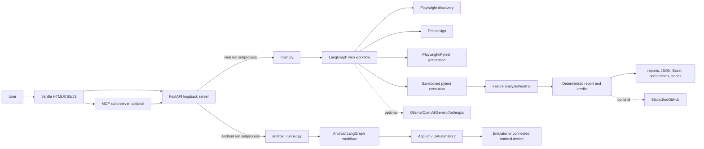

# Blow AI — Consolidated Project Audit

**Audit date:** 2026-11-10  
**Scope:** Static source/documentation review of the current workspace, plus the exact checks listed under Testing.  
**Safety:** This report is a new file. No existing application code or data was edited or deleted. The `.env` file was not opened or copied into this report.

## Evidence and confidence labels

- **Verified from source:** directly observed in files in this workspace.
- **Executed here:** command was run during this audit; the result below is the actual output.
- **Documented historical result:** an earlier project report records the result, but it was not rerun here and may predate later edits.
- **Unknown / unverified:** the source or available evidence does not establish the claim.

This is a source audit, not a claim that every URL, device, provider, or third-party account works. The working tree has no usable Git metadata (`git status` returned “not a git repository”), so changed-file history and tracked-file state cannot be established.

## 1. Project overview

Blow AI is a Windows-oriented local QA application. It accepts a website URL, a GitHub project, or a local project folder; discovers web pages and controls; designs and executes Playwright/Pytest tests; and produces reports. It also has a separate Android/Appium workflow, optional QA contracts and oracles, optional integrations, and a local MCP server.

The declared product objective is to test websites and Android apps automatically. The implementation is extensive, but it cannot guarantee “every functionality” on an arbitrary application: both crawlers are bounded, some interactions require explicit expected behavior or approval, and inaccessible/dynamic states cannot be inferred exhaustively. This is also how the product’s own reports are designed to behave: disclose coverage and label unvisited, blocked, untested, or inconclusive work.

## 2. Directory structure and file inventory

The workspace has 2,259 files matching the initial broad file listing, including local run output, APKs, browser binaries, virtualenv/cache content, and Android build intermediates. Those are not all source files. The main source and project areas are:

```text
Blow Ai/
├── main.py                         CLI pipeline entry point
├── backend/                        FastAPI server, web/Android QA engine, agents
│   ├── agents/                     setup, discovery, design, generation, execution,
│   │                                failure analysis, healing, reporting
│   ├── llm/                        provider wrapper and prompt templates
│   └── templates/                  generated web/Android pytest support
├── frontend/                       vanilla HTML, CSS, JavaScript UI
├── tests/                          product tests, practice websites, Android fixtures
│   └── android_demo/               Java Android fixture and generated Gradle build output
├── demo-apps/                      APKs and demo/check configuration
├── setup/                           Windows install and MCP configuration scripts
├── docs/                            user guides and implementation/verification notes
├── project-docs/                    PRD, architecture, rules, feature and status reports
├── .github/workflows/ci.yml         Windows CI workflow
├── runs/, baseline/, workspace/     local output/state; not distributable source
├── accounts/, logs/                 local account/audit data; private runtime state
├── .venv/, caches, .snapshots/       machine-local environment, caches, snapshots
└── tools/chromedriver/               local ChromeDriver binary
```

### Important root files

| File | Purpose / observed status |
|---|---|
| `main.py` | CLI orchestration, setup/resume/recheck/merge/report handling. Calls the LangGraph workflow. |
| `ui.bat`, `run.bat` | Windows launchers; invoke installer/checks and start UI or CLI run. |
| `mcp_entry.py`, `mcp.bat`, `setup/install-mcp.bat`, `setup/mcp_config.py` | Optional MCP stdio entry point, launcher, dependency installer, and client config generator. |
| `requirements.txt`, `requirements-dev.txt`, `requirements-mcp.txt`, `constraints.txt` | Runtime, developer/test, optional MCP dependencies, and transitive pins. |
| `pyproject.toml`, `pytest.ini` | Ruff configuration and test discovery/markers. |
| `.env.example` | Names and defaults for configuration; contains no live values in this audit. `.env` exists but was not read. |
| `.gitignore` | Excludes secrets, run data, local state, caches, and downloaded binaries. |
| `README.md`, `DEPLOYMENT.md`, `SECURITY.md`, `CONTRIBUTING.md` | Setup, operation, deployment, security boundaries, and contribution guidance. |
| `MCP_IMPLEMENTATION_STATUS.md` | Explicitly records MCP checks still deferred. |

### Backend modules

The backend contains about 95 files including submodules and prompt/template files. Main module responsibilities, verified from source and `backend/README.md`:

- **Web orchestration and state:** `graph.py`, `state.py`, `runctl.py`, `server.py`, `config.py`, `cost.py`.
- **Web discovery/design/execution:** `agents/setup_agent.py`, `agents/discovery.py`, `agents/change_detection.py`, `agents/test_design.py`, `agents/script_generator.py`, `agents/executor.py`, `agents/failure_analysis.py`, `agents/self_healing.py`, `agents/reporter.py`.
- **Web capabilities:** `auth.py`, `observe.py`, `navigation.py`, `page_inventory.py`, `page_status.py`, `features.py`, `items.py`, `forms.py`, `form_rules.py`, `testdata.py`, `mobile.py`, `roles.py`, `jscov.py`.
- **Safety and privacy:** `safety.py`, `actions.py`, `privacy.py`, `privacy_api.py`, `secret_store.py`.
- **Reports and quality:** `metrics.py`, `accuracy.py`, `assert_strength.py`, `registry.py`, `story.py`, `advice.py`, `excel.py`, `visual.py`, `discovery_report.py`, `merge.py`, `review.py`, `recheck.py`, `repo_fix.py`, `integrations.py`, `qa_benchmark.py`.
- **AI:** `llm/__init__.py` and `llm/prompts/*.txt`, `ai_grounding.py`, `vision.py`.
- **Android:** `android.py`, `android_app.py`, `android_design.py`, `android_emulator.py`, `android_evidence.py`, `android_features.py`, `android_graph.py`, `android_interact.py`, `android_permissions.py`, `android_pipeline.py`, `android_reporting.py`, `android_runner.py`, `android_runtime.py`, `android_scroll.py`, `android_site.py`, `android_web.py`.
- **QA contracts/oracles:** `qa_contracts.py`, `qa_runtime.py`, `qa_oracles.py`, `qa_web.py`.
- **MCP:** `mcp_api.py`, `mcp_bridge.py`, `mcp_server.py`.
- **Templates:** `templates/conftest.py`, `templates/pytest.ini`, `templates/android_conftest.py`, `templates/android_mobile_test.py`.

### Frontend, tests, docs, and fixtures

- `frontend/chat.html`, `chat.css`, `chat.js`: primary chat/test UI, styling, state, APIs, progress, reports and actions.
- `frontend/contract-builder.js`, `workflow.js`, `qa-lab.html`, `qa-lab.js`: QA contracts, workflow/privacy selection, and accuracy/QA presentation UI. `android-testing-guide.html` and its images document Android setup.
- `tests/`: more than 100 test/fixture files, including unit, API, integration, pipeline, UI, Android, accuracy and “lessons” regressions; practice sites include `demo_app.py`, `demo_store.py`, `classic_shop.py`, `admin_portal.py`, `travel_site.py`, and `big_store.py`.
- `tests/android_demo/`: Java fixture app, manifest, Gradle files, and build output. The build/intermediates and APK outputs are generated artifacts present in this checkout.
- `demo-apps/`: Android APK binaries and JSON test/check definitions. `tools/chromedriver/chromedriver.exe` is a local browser driver.
- `docs/` and `project-docs/`: setup, Android, MCP, privacy, execution, reliability, feature and verification documentation. Several status documents explicitly say later checks are deferred.
- `baseline/`, `runs/`, `logs/`, `accounts/`, `workspace/`: local runtime artifacts/data, not application source. `baseline/127.0.0.1_*` contains repeated saved baseline sets.

The above is a functional inventory, not a line-by-line dump of every helper function. An AST-level call graph and line-by-line review of all 2,259 workspace files were not performed. Binary APKs, generated build intermediates, caches, run artifacts, and private local state were not inspected as source.

## 3. Technology stack

| Technology | Version/configuration evidence | Where / role | Assessment |
|---|---|---|---|
| Python | `pyproject.toml` requires >=3.13; docs describe 3.13/3.14 Windows support. Runtime is pinned/tested in docs as 3.13. | Backend, agents, CLI, tests, automation. | Configured; exact active interpreter version was not queried for this report. |
| FastAPI / Uvicorn | Pinned in `requirements.txt` as FastAPI 0.143.1 and Uvicorn 0.54.0. | Local UI/API server, `backend/server.py`. | Dependency consistency check passed; application boot not tested here. |
| Vanilla JavaScript / HTML / CSS | `frontend/README.md`; no frontend package/build manifest. | Browser UI. | No frontend bundler or component framework. Responsive/accessibility behavior is source-implemented but not fully browser-audited here. |
| Playwright | Pinned 1.64.0. | Web discovery, generated tests, browser checks. | Source configured; one test module was attempted; live website not run in this audit. |
| pytest / pytest-xdist | Pinned 9.1.1 / 3.8.0. | Generated web/mobile suites and project regression suite. | Used in source and CI. |
| LangGraph / SQLite checkpoint plugin | Pinned 1.2.15 / 3.1.2. | Orchestrates web runs and checkpoints/resume. | Source configured. SQLite here is chiefly workflow checkpoint state, not a product business database. |
| Pydantic | Pinned 2.14.1. | API/request/contract validation and structured AI outputs. | Configured. |
| Appium Python Client / Selenium | Pinned 6.0.0 / 4.46.0. | Android WebDriver/Appium execution; CSS locators in WebView only. | Source configured; live device behavior not rerun here. |
| Java / Gradle | `tests/android_demo` includes Java and Gradle Kotlin DSL. | Controlled Android fixture app. | Build outputs exist; no Android build was run during this audit. |
| SQLite | Python `sqlite3` for local read-only QA oracle and LangGraph checkpoints. | QA oracle reads explicitly configured SQLite; run state checkpoints. | No ORM, product schema, or migration framework was found. |
| LLM providers | Source/config support Ollama, OpenAI, Gemini, Anthropic, and no-AI rules mode. | Test design, explanations, optional vision. | Optional; live provider integrations were not contacted. |
| External APIs | GitHub REST/API and git clone/download; Slack webhook; Jira REST; optional user-approved external API GET checks; MCP SDK. | PR preparation/creation, notifications/issues, QA oracle, assistant integration. | Configured in source/docs; no external services were contacted. |
| CI | GitHub Actions Windows runner, Python 3.13, Ruff and pytest. | `.github/workflows/ci.yml`. | Workflow source is present; CI was not run remotely. |
| Hosting | Local Windows desktop, loopback UI. | `ui.bat`, FastAPI. | Shared server/Docker deployment explicitly unsupported by `DEPLOYMENT.md`. |

No React/Vue/Angular UI, frontend package manager, ORM, database migration tool, cloud-hosted application, or distributed job queue was found. npm/Node is an optional Android/Appium prerequisite, not a frontend build system.

## 4. System architecture and data flow



**Frontend:** static page served by FastAPI. `chat.js` handles web/Android selection, checks, submission, progress polling, reports, schedules, review, rechecks and repo-fix UI. `workflow.js` supports privacy/assistant-workflow selection. `qa-lab.js` presents benchmark results.

**Backend:** FastAPI validates input, checks local policy, manages a single active run lock, starts a separate process and returns bounded job/report data. Web and Android use distinct graph paths and output formats with shared state/reporting concepts.

**State and storage:** LangGraph checkpoints use local SQLite; web and Android artifacts are files beneath `runs/`. Baselines are files beneath `baseline/`; generated account credentials may be DPAPI-encrypted under `accounts/`; schedules and audit logs are local files. No product-managed relational schema was found. A user may explicitly configure an external application SQLite database for read-only checks; that is not Blow AI’s own business database.

**Authentication and authorization:** Blow AI has no user login. The local-only server restricts hostnames and mutating HTTP requests require `X-Agentic-QA: 1`; the run endpoint also asks for target authorization. Web roles mean roles in the site under test, not Blow AI user accounts. MCP data access is separately gated by privacy policy. This architecture is documented as unsuitable for network/shared-server exposure.

**Error handling:** workflows preserve partial reports on failures/stops; run status/logs are polled; inputs and generated scripts are validated; failures are classified. Error-path quality varies by stage and was not exhaustively fault-injected.

**Logging/monitoring:** local run logs, report artifacts, audit JSONL, stage markers, and test traces. No external metrics/observability platform was found.

## 5. Feature analysis and implementation status

| Feature | Source implementation | Status based on evidence |
|---|---|---|
| URL/local/GitHub project intake | `main.py`, `backend/agents/setup_agent.py`, `backend/server.py`, `frontend/chat.js` | Implemented. Running arbitrary trusted repo code on the PC is an explicit risk. |
| Website reachability check/provider chooser | `server.py`, `chat.js` | Implemented; live provider/network behavior not tested here. |
| Web discovery and inventory | `agents/discovery.py`, `observe.py`, `page_inventory.py`, `registry.py` | Implemented with crawl limits, scope rules, and coverage accounting. Cannot guarantee literally all pages or states. |
| Web feature and test design | `agents/test_design.py`, `features.py`, `forms.py`, `form_rules.py`, `testdata.py`, `qa_contracts.py` | Implemented; app-specific behavior may need requirements/contracts. |
| Playwright/Pytest generation and sandbox | `agents/script_generator.py`, `agents/executor.py`, `templates/conftest.py` | Implemented. Generated code is statically checked and runs with guards/process limits; not a container. |
| Failure diagnosis/self-healing | `agents/failure_analysis.py`, `agents/self_healing.py` | Implemented with bounded repair and assertions preserved by design; newest edits require regression evidence. |
| Web report/verdict/export | `agents/reporter.py`, `metrics.py`, `excel.py`, `story.py`, `advice.py` | Implemented; verdict gates are deterministic per docs/source. |
| Baseline/visual comparison/change detection | `agents/change_detection.py`, `visual.py`, `registry.py` | Implemented; baseline/visual approval behavior not exercised in this audit. |
| Android mode and environment preparation | `chat.html`, `chat.js`, `server.py`, `android.py`, `android_emulator.py` | Implemented. Historical UI-to-APK E2E recorded; not rerun here. |
| Android discovery, design, Appium/Pytest run | `android_pipeline.py`, `android_design.py`, `android_runtime.py`, `android_runner.py`, Android templates | Implemented and bounded. Android evidence is not a guarantee of all app features. |
| WebView/native locator behavior | `qa_contracts.py`, `qa_runtime.py`, `android.py` | CSS locators are explicitly required/allowed in WebView and rejected in native context. Native uses accessibility/resource/text/XPath strategies. |
| Approved workflows, API/DB oracles | `qa_contracts.py`, `qa_runtime.py`, `qa_oracles.py`, `qa_web.py` | Implemented. SQLite oracle is read-only; external HTTP oracle is bounded and contract/origin constrained. |
| Accuracy lab/benchmark | `qa_benchmark.py`, `qa-lab.*`, tests/truth data | Implemented, but documentation says complete repeated-device benchmark is deferred; no general accuracy percentage is established. |
| MCP assistant interface | `mcp_server.py`, `mcp_bridge.py`, `mcp_api.py`, setup/docs | Implemented in source. Protocol round trips and live automation are explicitly unverified/deferred in status docs. |
| Repo-fix preview and PR | `repo_fix.py`, `server.py`, `chat.js`, `codefix.py` | Implemented; no dedicated functional GitHub repo-fix test was found. External PR behavior was not exercised. |
| Slack/Jira/webhook/schedules | `integrations.py`, `server.py`, `.env.example`, `chat.js` | Implemented as optional source paths; no external integration call made here. |

### User workflow examples

- **Web:** user selects Web, enters target, confirms permission/configuration, submits `/api/runs`; server starts `main.py`; graph discovers, designs, generates, executes, analyzes and reports; UI polls status and renders artifacts.
- **Android:** user selects Android, selects APK/installed package/Android Chrome, device and bounded scope; UI calls environment/prepare then `/api/mobile/runs`; server validates and stores private config/APK, starts `android_runner.py`; Appium/UiAutomator2 drives the target; report is polled/rendered.

## 6. Frontend audit

The UI uses plain HTML, CSS, and JavaScript; no frontend framework or package/build step is configured. Main route is `/`; `/qa-lab` serves the QA lab. `chat.js` implements mode switching, provider/workflow/privacy controls, live web and Android job views, test case/report/coverage display, run history, review, stop/recheck, visual approval, repo-fix, schedules and deletion. `workflow.js` handles standard vs assistant workflow and privacy controls.

`frontend/README.md` documents API use and an HTML escaping rule (`esc(...)`) for untrusted website/run text. The UI stores preferences and confirmed website permissions; it should not persist API keys/passwords per docs/source. Static browser rendering, accessibility, responsive behavior, console errors, keyboard-only interaction and cross-browser compatibility were not tested in this audit. Fonts may load from Google Fonts; local/system fallback is documented.

No component library, frontend state library, or CSS framework was found. The UI’s complexity is concentrated in large vanilla JS files; modularization is a maintainability opportunity, not a demonstrated runtime defect.

## 7. Backend and API audit

### API surface observed in `backend/server.py`

| Method/path | Purpose |
|---|---|
| `GET /` | Serve primary UI. |
| `GET /api/check` | Check source reachability/title/status. |
| `GET /api/providers` | Provider/model availability. |
| `POST /api/runs` | Start standard web run. |
| `GET /api/android/environment` | Report Android/Appium/device readiness. |
| `POST /api/android/prepare` | Prepare/boot authorized Android emulator/device. |
| `POST /api/mobile/runs` | Start Android Appium run; accepts form fields and optional APK upload. |
| `GET /api/runs/latest`, `GET /api/runs/{job_id}` | Latest/live job state and logs. |
| `GET /api/pages/{run}`, `GET /api/components/{run}` | Page and component inventories. |
| `GET /api/runs/{job_id}/review`, `POST /api/runs/{job_id}/review` | Human review questions/answers. |
| `POST /api/runs/{job_id}/stop` | Stop a run. |
| `GET /api/history` | List saved run history. |
| `GET /api/report/{run}`, `GET /api/coverage/{run}` | Report and coverage data. |
| `GET /api/cases/{run}`, `GET /api/cases/{run}/download` | Cases and download. |
| `GET /api/excel/{run}`, `GET /api/excel/{run}/download` | Excel availability/download. |
| `DELETE /api/runs/{run}` | Delete a run and related baseline as implemented. |
| `GET /api/runs/{run}/repo-fix` | Repo-fix metadata. |
| `POST /api/runs/{run}/repo-fix/prepare`, `/create` | Prepare diff; create GitHub branch/PR. |
| `POST /api/runs/{run}/recheck`, `GET /api/runs/{run}/recheck` | Recheck selected findings/status. |
| `GET /api/schedules`, `POST /api/schedules`, `DELETE /api/schedules/{sid}` | Manage local schedules. |
| `POST /api/visual/{run}/approve` | Approve visual baseline. |
| `POST /api/hooks/run` | Token-authenticated run trigger. |
| `POST /api/shutdown` | Local UI shutdown. |
| `GET /qa-lab` | QA lab UI. |
| `GET /api/contracts/schema`, `/examples`, `/examples/{example_id}` | Contract schemas/examples. |
| `POST /api/contracts/validate` | Validate QA contract. |
| `POST /api/qa/benchmark` | Build benchmark from run manifest. |

Additional MCP/privacy routes are registered through `backend/privacy_api.py` and MCP modules; complete request/response schema transcription was not performed. API authorization, validation, error codes, and consumer mappings are distributed in `server.py` and frontend callers. A generated OpenAPI schema was not saved as part of this audit.

### External service integrations

- LLM calls: OpenAI, Google Gemini, Anthropic Claude, local Ollama; provider wrapper `backend/llm/__init__.py` and privacy enforcement. No calls made.
- Browser/device: Playwright Chromium; Appium server/UiAutomator2, Android SDK/ADB, JDK and ChromeDriver for webview. No live device call made here.
- GitHub: repository clone/download and GitHub REST operations for pull requests (`repo_fix.py`). Not exercised.
- Jira/Slack: optional integrations (`integrations.py`). Not exercised.
- MCP: stdio SDK server proxies to loopback UI/API. Status docs state round-trip verification deferred.
- Test target APIs: optional explicitly configured read-only GET/JSON oracles. SQLite SELECT checks are read-only.

## 8. Database audit

No Blow AI business database schema, ORM model set, migration files, or migration runner was found. Local SQLite use is for LangGraph checkpointing and configured read-only inspection of a target application’s SQLite database. Report/test data is primarily JSON/JSONL/HTML/XLSX/images/traces on disk. Schedule and audit data are file-based. Therefore an ER diagram for a product database is **N/A**; modeling the checkpoint plugin as business data would be misleading.

The QA SQLite oracle opens configured target databases read-only and limits/authorizes query operations in `backend/qa_oracles.py`. Test fixtures create temporary SQLite schemas. These do not constitute Blow AI production tables.

## 9. Security audit

### Positive controls observed

- `backend/server.py` binds policy to loopback hostnames and requires `X-Agentic-QA: 1` for mutating requests (except separately token-checked webhook). UI has no login and is documented as local-only.
- `backend/safety.py` validates HTTP(S) targets, blocks cloud metadata, checks private hosts, tracks approved host scope, and provides redaction/clean child environments.
- Generated web code is import/AST checked (`script_generator.py`) and runs in a child process with runtime guards and Windows Job Object limits (`executor.py`, generated `conftest.py`). Docs correctly say this is not a container.
- APK upload is size-bounded, filename/extension and APK validation are present, and APK/config are placed in a private run directory; hidden/private artifacts are excluded from static serving (`RunFiles`).
- Sensitive test account storage uses DPAPI on Windows (`secret_store.py`); typed run passwords are intended to remain memory-only. `.env` and local state are gitignored.
- MCP access and cloud processing require separate privacy policy checks in source/docs. The assistant cannot self-authorize per docs.
- Run actions, writes, and protected actions have environment/approval gates in `actions.py`, config, server and contract runtime.

### Findings and limitations

| ID/severity | Finding | Evidence and impact |
|---|---|---|
| SEC-01 / Informational, by design | Local UI has no authentication. | `DEPLOYMENT.md`, `SECURITY.md`, and server middleware state loopback-only operation. Exposing the service through a reverse proxy/network would expose run controls and artifacts. Do not deploy as shared service without a separate auth/isolation design. |
| SEC-02 / Medium, documented limitation | Generated test sandbox is not a container. | Runtime guards and Job Object are useful layers, but not equivalent to OS/container isolation. Trusted repo setup also runs project code on the local PC. Only test repositories the user trusts. |
| SEC-03 / Unknown | Dependency vulnerability status. | Pins and `pip check` establish dependency consistency, not CVE status. No vulnerability database audit was run. |
| SEC-04 / Unknown | Full XSS/CSRF review. | Source uses escaping and loopback/custom-header checks, but no dynamic browser security test or complete sink audit was run. No exploitable issue is asserted. |
| SEC-05 / Informational | Account encryption portability differs by platform. | Windows DPAPI; non-Windows fallback is plaintext with restrictive chmod where available, per `secret_store.py`. Deployment docs scope Windows. |

No credentials or live `.env` values were inspected or included. No destructive security test or external service was contacted.

## 10. Issues, incomplete work, and technical debt

### Confirmed from executed checks

- **AUD-01 — pytest temp-directory setup errors (environment issue, not yet a product-test failure).** `tests/test_qa_contracts.py`: 18 passed, 5 errors, exit code 1. The five errors occurred before test bodies because pytest could not scan `C:\Users\manikanta.akuthota\AppData\Local\Temp\pytest-of-manikanta.akuthota` (`PermissionError: [WinError 5] Access is denied`). Root cause is an inaccessible pytest temp root in this execution environment. The tests’ correctness is undetermined for those five cases.
- **AUD-02 — no Git metadata in workspace.** `git status --short` failed with “fatal: not a git repository”; change history/working tree status is unknown.
- **AUD-03 — report claims of exhaustive coverage need scope qualification.** Config/source enforce finite page, depth, interaction, test-case and run limits (`config.py`, `android` request/config validation). Literal full functionality coverage cannot be promised for all arbitrary sites/apps.

### Static-review risks (not confirmed runtime failures)

- `backend/repo_fix.py` has real `prepare()` and `create_pr()` implementations and is called by `server.py` and `chat.js`; it is not an empty feature. However, a dedicated behavior test was not found. In `prepare()`, if a single finding contains several tag changes and only some are found, it can record the finding as applied without recording the missing subset as skipped. This may make a partial preview look complete. GitHub PR execution remains unverified.
- `tests/android_demo/app/build/` contains generated build intermediates/output in the workspace. Whether these artifacts are intentionally distributed cannot be determined; deployment docs say local/build output should not be copied as source.
- Baseline snapshots include multiple repeated `127.0.0.1_*` directories. They are runtime data and not proof of duplicated executable logic.
- Large vanilla JS and Python agent modules carry many responsibilities; this is maintainability risk, not a demonstrated functional failure.

## 11. Testing and coverage report

### Commands executed in this audit

| Command | Result |
|---|---|
| `.\.venv\Scripts\python.exe -B -m pytest -p no:cacheprovider -q tests/test_qa_contracts.py` (with `PYTHONDONTWRITEBYTECODE=1`) | Exit 1; **18 passed, 5 setup errors** in 2.58s. All 5 errors were `PermissionError [WinError 5]` while pytest enumerated the external Windows temp directory. No failing assertion was reported. |
| `.\.venv\Scripts\python.exe -B -m pip check` | Exit 0; `No broken requirements found.` |
| `.\.venv\Scripts\ruff.exe check . --no-cache` | Exit 0; `All checks passed!` |
| `git status --short` | Could not run successfully; workspace is not a Git repository. |

No full test suite, browser UI, live web target, Android emulator, Appium protocol session, MCP protocol round trip, cloud AI, Slack/Jira, or GitHub PR was run in this audit.

### Historical results in repository documents (not rerun here)

- `project-docs/ANDROID_IMPLEMENTATION_REPORT.md` records 342 passing non-slow tests and Android/device runs from an earlier phase.
- `project-docs/ADVANCED_QA_VERIFICATION.md` records 71 focused QA/Android passes and a web pipeline pass before final small edits. It explicitly says final later changes, repeated-device benchmark, full regression, UI E2E, and component/menu updates were deferred.
- `MCP_IMPLEMENTATION_STATUS.md` records syntax/schema/dependency checks but says MCP protocol round trips, live crawl, Playwright/Appium and regression checks were deferred.
- These historical figures are not evidence that current checkout fully passes.

Test organization includes unit/contract checks, local practice-site integrations, real pipeline tests, Android mocks/device tests, UI E2E, fixtures and truth datasets. Device/UI E2E tests are marked opt-in/slow. The failed test attempt demonstrates that local test execution currently needs an accessible pytest temp directory.

## 12. Performance and scalability

No profiling, load test, memory measurement, or throughput benchmark was performed. Source-level controls include page/depth/time caps, request pacing, worker count, budgets, per-test/run timeouts, bounded MCP responses, run locks and Android device locks. Risks/limits: browsers and parallel workers consume memory; a single UI worker/run lock limits throughput; local filesystem artifacts grow; full-site crawling is bounded; visual checks have a page cap; shared server deployment is unsupported. No caching/CDN/distributed worker system was found. Database query performance for customers’ configured DBs depends on their database and bounded contract query.

## 13. DevOps, install, and deployment

- `setup/install.bat` selects supported Python, creates `.venv`, installs pinned packages, installs Chromium, and creates `.env` if absent. **It can delete/recreate `.venv` when called with an incompatible interpreter**, so it was not run in this read-only audit.
- `ui.bat` starts local FastAPI after installer checks. `run.bat` supports CLI invocation.
- CI at `.github/workflows/ci.yml` uses Windows, Python 3.13, Ruff and pytest; slow tests run only when manually requested.
- Deployment docs support individual Windows PCs, not shared hosting/Docker. No backup/restore automation or production rollback strategy was verified.
- Runtime configuration comes from `.env`/environment. `.env.example` lists provider keys, crawl limits, safety/write policy, review, test accounts, sandbox, integrations, webhook, UI, and Android/QA options. The actual `.env` value set was deliberately not viewed.

## 14. Documentation assessment

Documentation is unusually extensive: README, backend/frontend guides, PRD, architecture, rules, Android/MCP/privacy guides, deployment/security guides, test instructions and dated verification notes. Important caveat: reports differ by date/phase. The latest status document should govern; older reports are historical, and some later changes remain explicitly unverified. No single current requirements-to-test acceptance matrix was found. Recommend maintaining one status page linking each feature to a current test result and exact supported environment.

## 15. Gap analysis against stated product goal

| Goal | Actual implementation | Gap to a defensible completion claim |
|---|---|---|
| Select Website vs Android mode | Present in UI and wired to distinct backend routes/pipelines. | Run the current UI mode-selector E2E and verify input validation/error paths. |
| Crawl the entire website | Playwright discovery follows reachable in-scope routes with sitemap/link/interaction logic and reports caps/skips. | Cannot cover infinite/dynamic/private/unlinked pages or exceed budgets. Define “entire” as reachable within configured scope/caps and require report evidence. |
| Test every website functionality | Built-in feature cases, journeys, forms and optional contract/AI cases. | Unknown expected behavior and unobserved state transitions require app-specific requirements. Protected/destructive actions are blocked without approval. Validate per-run coverage and make missing evidence visible; no universal guarantee. |
| Test every Android feature | Bounded Appium discovery, generated tests, contract flows, recovery and report. | App-specific navigation and business rules need expectations/contracts. Discovery/test budgets cap coverage; some later verification is deferred. |
| Use Python/Pytest/Appium | Dependencies, runners, templates and source pipeline are present. | Current end-to-end verification must be rerun on the intended emulator/device and app. |
| Use CSS/WebView selectors | QA runtime requires CSS in WebView and rejects CSS in native context. | Specify native locator strategy separately; CSS selectors do not apply to native Android UI elements. |

## 16. Evidence-based scorecard

Scores assess code/documentation evidence, not production certification. **N/A** means insufficient evidence for a meaningful score.

| Area | Score | Reason |
|---|---:|---|
| Architecture | 7/10 | Clear stage-based pipelines and separation of web/Android; substantial modular scope, but several large modules and incomplete latest verification. |
| Frontend | 6/10 | Functional vanilla UI/API wiring and documented escaping/privacy rules; no current browser/accessibility/responsive audit. |
| Backend | 7/10 | Broad validation, safety, run state and reporting; complexity and incomplete live integration verification remain. |
| Database design | N/A | No product-owned business schema/ORM; SQLite used for checkpoints and test oracles. |
| API quality | 6/10 | Broad typed FastAPI surface and local controls; full API contract/consumer audit and live endpoint checks not performed. |
| Security | 6/10 | Strong local/sandbox/secret controls documented and implemented, but desktop sandbox is not a container, UI has no login by design, and no dependency vulnerability scan/full penetration test. |
| Performance | N/A | No profiling or load tests executed. |
| Testing | 5/10 | Extensive tests and historical passes; this run had 5 setup errors and latest E2E/regression verification is explicitly deferred. |
| Documentation | 8/10 | Extensive setup/architecture/security/verification docs; status is spread across dated reports with no single acceptance matrix. |
| Maintainability | 6/10 | Strong module coverage and pinned dependencies, but broad monolithic modules and artifacts in workspace increase maintenance burden. |
| Scalability | 4/10 | Designed for a single local Windows tester, one-run lock, local files; shared service is explicitly unsupported. |
| Deployment readiness | 5/10 | Clear Windows installer/CI and operational docs; no shared deployment, no production auth model, and latest checks are incomplete. |

## 17. Prioritized roadmap

Do not delete or replace existing functionality. Add coverage and fixes in isolated, reviewable steps.

| ID / priority | Task | Main files | Dependency / acceptance evidence | Complexity |
|---|---|---|---|---|
| P0-1 | Resolve pytest temp-root access and rerun the focused contract suite. | Test environment; `tests/test_qa_contracts.py` | Use an approved writable temp directory; all tests execute with no setup errors. | Low |
| P0-2 | Run current non-slow regression suite and record a clean baseline. | `tests/`, CI workflow | Tests complete with exact counts; distinguish failures from environment errors. | Medium |
| P1-1 | Run web contract pipeline and relevant web E2E regressions. | `tests/test_qa_web_pipeline.py`, web tests | Current checkout completes; report artifacts show seeded defects as expected. | Medium |
| P1-2 | Run Android unit/protocol/device contracts on declared target emulator. | `tests/test_android*.py`, `tests/test_qa_native_device.py` | Prerequisites recorded; clean/seeded/clean-repeat outcomes match expectations. | High |
| P1-3 | Run Android UI E2E, mode selection, APK/installed/WebView path. | `tests/test_qa_ui.py`, `frontend/chat.js` | Current UI can submit and render results; no browser errors; report matches fixture. | High |
| P1-4 | Run MCP protocol initialize/list/call and permission round-trip tests. | `tests/test_mcp_integration.py`, MCP modules | Actual protocol session succeeds; disabled/unauthorized behavior is denied. | Medium |
| P1-5 | Add a regression for partial repo-fix matches and verify GitHub flow with a disposable authorized repo/mock. | `repo_fix.py`, server routes, tests | Partial edits are visibly reported; no main-branch writes; stale-file handling verified. | Medium |
| P2-1 | Publish explicit coverage semantics for “entire site/app” and acceptance thresholds. | PRD, README, reports | Report always states configured caps, found/visited/tested/blocked/unvisited counts. | Medium |
| P2-2 | Expand labeled accuracy benchmark over repeated web and Android runs. | `qa_benchmark.py`, truth data | Precision/recall/coverage/instability measured with reproducible data; no claims from fixtures alone. | High |
| P2-3 | Review generated Android build artifacts and repeated local baselines for release hygiene. | `tests/android_demo/build/`, `baseline/`, `.gitignore` | Confirm intended distribution; do not remove anything without explicit approval. | Low |
| P3-1 | Consider modularizing oversized UI/backend modules without behavior change. | `frontend/chat.js`, `server.py`, agent modules | Characterization tests pass before/after; no endpoint/feature regression. | High |
| P3-2 | If shared deployment is ever required, design authentication, tenant isolation, container isolation, secret management and backups before implementing. | New deployment architecture | Security review and staging evidence; current single-user assumptions removed through additive migration only. | High |

## Final assessment

Blow AI is a substantial, feature-rich local testing product with implemented web and Android pipelines, extensive safety controls, broad tests, and detailed documentation. It is not defensible to claim 100% complete testing of every arbitrary site/app: exploration is bounded and expected behavior is partly application-specific. Current confidence is additionally limited by deferred latest regressions, unavailable Git metadata, and the focused pytest run’s Windows temp-directory setup errors. The next safest action is to fix the test temp location and obtain a current test baseline before changing application code.
