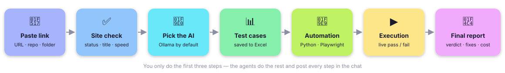

# 📋 Product Requirements Document (PRD)

### Blow AI – AI Agents That Test Your Website

| **Version** | 1.0 |
|---|---|
| **Date** | Oct 23, 2026 (feature status and roadmap updated Nov 4, 2026) |
| **Author** | Blow AI Team |
| **Status** | MVP built, plus the v1.0 additions in section 6 |
| **Target Launch** | MVP (v1.0) |

---

## 1. Product Overview

- **Blow AI** is a web application that tests any website automatically.
- You give it a **website link**, a **GitHub repo** or a **project folder**.
- A team of AI agents then:
  - finds every page of the website
  - writes the test cases to **Excel**
  - turns them into automated tests and **runs them live**
  - repairs scripts that broke
  - gives a plain-English **report**: what works, what to fix, and what the AI cost

## 2. Problem Statement

- Writing test cases and automation by hand takes **days for every release**.
- When the frontend changes (new button id, new page), old scripts **break** and must be fixed by hand.
- Test reports are **too technical** for managers and developers.
- Cloud AI tools can be **expensive** and may send **private page data** outside the company.

## 3. Goals

- Test any website **end-to-end without writing code**.
- Save every test case in **Excel** with steps, expected result, automation status, execution status and cost.
- Generate real automation in **Python · Playwright · PyTest** that can be re-run any time.
- **Self-heal** scripts broken by frontend changes – without hiding real bugs.
- Show the **AI cost** clearly: overall cost of the run and cost per test case (end-to-end).
- Be **private by default**: the local AI (Ollama) is the default, so no page data leaves the PC.

## 4. Target Users

- **QA engineers** – want test cases and automation written for them, ready to review and re-run.
- **Developers** – want a clear bug list with the exact line of code to change.
- **Team leads / managers** – want a release verdict (Ready / Not Ready) and the cost of every run.

## 5. Core Features (MVP)

### 5.1 Input and Setup
1. **Smart input** – website URL, `localhost:<port>`, GitHub repo link or local project folder.
2. **Website check** – opens the site once and shows title, HTTP status and load time.
3. **AI engine picker** – Ollama (default), Gemini, OpenAI, Claude or No AI; choose the model; paste a key for one run.
4. **Auto setup for code** – downloads, installs and starts the project on localhost.

### 5.2 Testing
5. **Discovery** – visits every page on the same domain, takes screenshots, records errors.
6. **Change detection** – finds new, changed, removed and unchanged pages since the last run.
7. **Test design → Excel** – smoke, positive, negative, boundary and test-data cases; in-page Excel viewer.
8. **Script generation** – Playwright + PyTest scripts; a regression run re-uses the last run's scripts unchanged.
9. **Live execution** – 4 browsers in parallel, or one visible Chrome window to watch every click.
10. **Failure analysis** – website bug, script bug, flaky test or network problem, with severity.
11. **Self-healing** – repairs broken selectors (max 2 rounds), never removes assertions.

### 5.3 Results
12. **Final report** – verdict, what works well, what to fix step by step (why · how · code change).
13. **Cost analysis** – overall cost, cost per test case, cost per 100 cases, AI calls and tokens.
14. **Recent tests** – reopen or delete any earlier run.
15. **Apply fixes as a Pull Request** – preview the code changes, then open a PR on a new branch.

## 6. Feature Status

- ✅ **Done (v1.0):** features 1 – 15 above, plus the chat UI with the live to-do list and step messages.
- ✅ **Added since (v1.0):** login with a test account (also 2-step codes from an authenticator key), several user
  roles, the staging environment (forms sent, records created → edited → deleted), human review of the test cases,
  your own tests in plain English, the visual check (approved look per page, desktop + phone), the AI looking at
  screenshots, re-check after a fix, scheduled tests, Slack / Jira / webhook, GitHub Actions (CI and testing your
  website), `--resume`, `--section` / `--merge` / `--incremental` for very large sites, and the Windows sandbox for
  the generated tests.
- ⏳ **Planned (v1.1):** Docker sandbox for testing untrusted GitHub / folder code.

## 7. Non-Functional Requirements

- **Privacy**
  - Local AI by default.
  - Pasted API keys are used for one run only and never written to disk.
- **Safety**
  - AI-written code is checked before it runs.
  - Dangerous links and buttons are never clicked; forms are never sent (only on staging, the owner's test copy).
- **Reliability**
  - If the AI is slow or fails, the step uses built-in rules and the run continues.
- **Performance**
  - Up to 4 browsers in parallel.
  - Each AI answer has a time limit (`LLM_TIMEOUT`, default 240 s).
- **Usability**
  - Plain English in the chat and the report; no coding knowledge needed.
- **Platform**
  - Windows first (double-click `ui.bat`); the Python code also runs on Mac and Linux.

## 8. Out of Scope (v1.0)

- Load / performance testing and security penetration testing.
- Submitting real forms, payments, deleting data or logging out (blocked on purpose; on staging, forms are sent and
  the others only when named in `ALLOW_ACTIONS`).
- Testing websites you don't own or don't have permission to test.
- Native iOS apps. Android uses the Appium adapter described in 12_ANDROID.md; responsive websites retain Playwright.
- Multi-user accounts and cloud hosting (it runs on your own PC).

## 9. Success Metrics

- A first run on a practice site finishes **without any manual help**.
- After a frontend change, broken scripts are **healed** and real bugs are **still reported**.
- The cost in the report **equals the sum** of the AI calls in `llm_usage.jsonl`.
- A non-technical reader can tell from the report **whether the site is ready to release**.

## 10. Roadmap

- **v1.0 (MVP)** – everything in section 5, plus the additions in section 6.
- **Done early (planned for v1.1):** CI pipeline (`.github/workflows/ci.yml`) · API tests for the server
  (`tests/test_server.py`).
- **Done (were ideas):** scheduled runs · compare two runs (regression run, same test IDs) · Slack summary.
- **v1.1** – Docker sandbox.
- **Ideas (not decided)** – email summary · a shared server with logins (see `DEPLOYMENT.md`).

---

**Related documents:** [Architecture](02_ARCHITECTURE.md) · [Rules](03_RULES.md) · [Design](04_DESIGN.md) ·
[Execution Process](05_EXECUTION_PROCESS.md) · [Installation](06_INSTALLATION.md)

