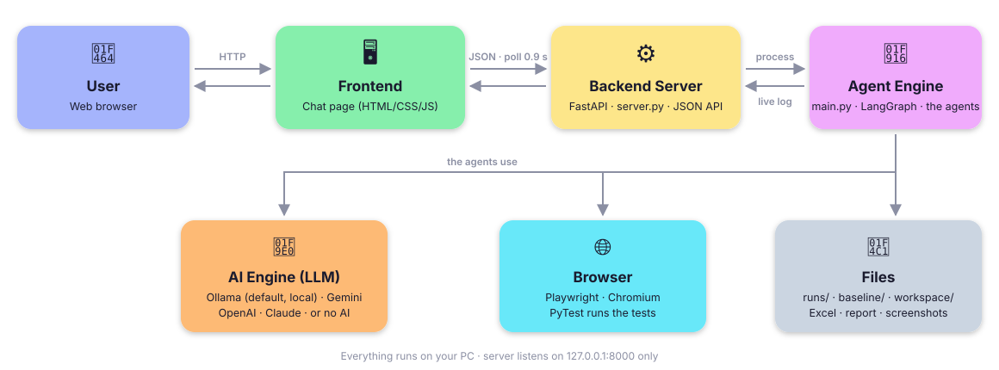
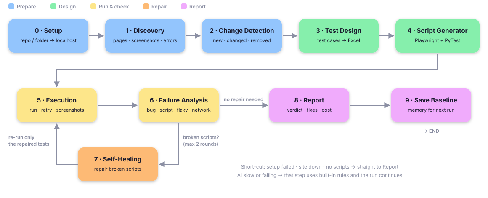

<div style="font-family: 'Segoe UI', Inter, system-ui, -apple-system, Roboto, Arial, sans-serif; line-height: 1.6;">

# 🏛️ System Architecture

### Blow AI – AI Agents That Test Your Website

| **Version** | 1.0 |
|---|---|
| **Date** | Oct 23, 2026 (checked against the code Nov 4, 2026) |
| **Status** | Matches the code as of Nov 4, 2026 |

This document describes the system architecture, technology stack, folder structure, agent pipeline,
data flow and key design decisions.

---

## 1. High-Level Architecture

Blow AI is a **local full-stack application** that runs on your own PC.



### 1.1 Main Parts
- **User** – opens `http://127.0.0.1:8000`, pastes a link, picks the AI and watches the run.
- **Frontend** – the chat page. No build step.
- **Backend server** – starts one engine process per run, reads its live output, serves results as JSON.
- **Agent engine** – runs the agents in order (13 steps, section 4) and shares one state object between them.

### 1.2 Services the Agents Use
- **AI engine** – writes test cases, scripts, repairs and explanations. Optional: rules work without it.
- **Browser** – Playwright drives Chromium to crawl the site and run the tests.
- **Files** – every run is saved in its own folder; the last run of each site is kept as a baseline.

## 2. Technology Stack

| Layer | Technology | Purpose |
|---|---|---|
| Frontend | HTML · CSS · JavaScript | Chat UI (no build step) |
| Language | Python 3.13 | Backend, agents and generated tests |
| Web server | FastAPI + Uvicorn | JSON API on `127.0.0.1:8000` |
| Orchestration | LangGraph | Agent pipeline + self-healing loop |
| Browser automation | Playwright (Chromium) | Crawling and running tests |
| Test runner | PyTest + pytest-xdist | Runs tests, 4 browsers in parallel |
| Excel | openpyxl | `test_cases.xlsx` |
| AI calls | requests (REST) | One wrapper for all AI providers |
| AI engines | Ollama · Gemini · OpenAI · Claude | Default: Ollama (local, free, private) |
| Configuration | `.env` | Settings and API keys |
| Launch | `ui.bat` / `run.bat` | One-click setup and start on Windows |

## 3. Folder Structure

```text
blow-ai/
├── frontend/                 # The web page (served at /static)
│   └── chat.html/.css/.js    #   Chat view – the page at /
│
├── backend/                  # The Python engine
│   ├── server.py             #   FastAPI server: API + starts runs
│   ├── graph.py              #   LangGraph orchestrator (agent order + routing)
│   ├── state.py              #   Shared state passed between agents
│   ├── config.py             #   Settings from .env
│   ├── agents/               #   One file per agent
│   ├── llm/                  #   AI wrapper + prompts/*.txt
│   ├── excel.py              #   Test cases + results -> Excel
│   ├── cost.py               #   Tokens and $ per run / per test case
│   ├── advice.py, story.py   #   "What to fix" + plain-English report text
│   ├── codefix.py            #   "Code now -> Change to"
│   ├── repo_fix.py           #   Apply fixes as a GitHub Pull Request
│   ├── visual.py, review.py, integrations.py  # Visual check, human review, Slack / Jira
│   ├── ...                   #   every other module: backend/README.md
│   └── templates/conftest.py #   Fixtures copied next to every generated test
│
├── main.py                   # Runs one full pipeline
├── ui.bat / run.bat          # Double-click launchers
├── setup/install.bat         # The installer: only what is missing (double-click it, or the launchers call it)
├── requirements.txt          # Python packages (pinned); constraints.txt pins every package; requirements-dev.txt adds the checker
├── .env / .env.example       # Your settings / the template
├── .github/workflows/        # CI (ruff + quick tests) and testing your website in GitHub Actions
├── tests/                    # Tests for the tester itself
├── project-docs/             # These documents
├── runs/                     # OUTPUT: one folder per run
├── baseline/                 # Last run per site (change detection, approved look, your own tests)
├── accounts/, logs/          # Encrypted test accounts the tester created; the audit log
├── schedules.json            # Scheduled tests
└── workspace/                # Downloaded GitHub repos
```

## 4. Agent Pipeline



### 4.1 The Agents
The diagram shows the core agents; the steps marked ➕ run between them (`graph.py` has all 13).
0. **Setup** (`setup_agent.py`) – repo / folder → app running on localhost. Websites skip this step.
1. **Discovery** (`discovery.py`) – visits pages; collects links, buttons, inputs, forms, errors, screenshots.
2. **Change Detection** (`change_detection.py`) – compares with the baseline: new / changed / removed / unchanged.
   - ➕ **Visual check** (`visual.py`) – each page's look (desktop + phone) vs. its approved look (`VISUAL_CHECK`).
3. **Test Design** (`test_design.py`) – designs the test cases and saves them to **Excel**.
   - ➕ **Review gate** (`review.py`) – asks a person what the tester can't know (on staging, or `REVIEW=on`).
4. **Script Generator** (`script_generator.py`) – writes and validates Playwright + PyTest scripts.
5. **Execution** (`executor.py`) – runs the tests in parallel; with `TEST_RETRIES` it re-runs failures.
6. **Failure Analysis** (`failure_analysis.py`) – gives each failure a category and a severity.
7. **Self-Healing** (`self_healing.py`) – repairs broken scripts and sends them back to Execution.
8. **Report** (`reporter.py`) – verdict, `report.html`, final Excel, cost.
9. **Save Baseline** (`change_detection.py`) – stores this run for the next comparison.
   - ➕ **Integrations** (`integrations.py`) – Slack / Jira, only when set in `.env`.

### 4.2 Routing Rules (`graph.py`)
- **Setup failed** → go straight to Report.
- **No page loaded** → Failure Analysis → Report.
- **No scripts written** → Failure Analysis → Report.
- **Broken scripts and rounds left** → Self-Healing → Execution (only the repaired tests).
- **Otherwise** → the next agent in order.

## 5. Data Flow

### 5.1 How the Page Follows a Run Live
1. The server starts `main.py` as a **separate process**.
2. `graph.py` prints `::stage::<agent>::start` and `::done` around every agent.
3. The server turns these lines into **to-do ticks** (and `::page::{...}` into the live page list, `::human::{...}`
   into "please type the code in the Chrome window"); other lines become the **live log**.
4. `conftest.py` writes each result to `results.jsonl` **as soon as a test finishes**.
5. Every AI call is logged to `llm_usage.jsonl`, so the **cost updates live**.
6. The page asks for updates about **every 0.9 seconds** and only redraws what changed.

### 5.2 Sequence
```text
 Chat page                  server.py                        main.py (engine)
 POST /api/runs  ────────▶  start main.py  ────────────────▶  agents start
 GET /api/runs/{id} ◀────  stages + log + cost  ◀──────────  ::stage:: lines
 GET /api/cases/{run} ◀──  live test-case status ◀────────  results.jsonl
 report card ◀───────────  GET /api/report/{run} ◀────────  summary.json, report.html
```

## 6. API Endpoints

### 6.1 Pages
- `GET /` – chat view (the only page; the 3D and guided views were removed on Nov 2, 2026)

### 6.2 Running a Test
- `GET /api/check?source=` – is the website reachable, or is it a repo / folder?
- `GET /api/providers` – AI engines, whether a key is set (never the key), whether Ollama is running
- `POST /api/runs` – start a run
- `GET /api/runs/latest` – last run (resume after a page refresh)
- `GET /api/runs/{id}?since=&psince=` – live status: stages, new log lines, new pages, cost, counts
- `GET` / `POST /api/runs/{id}/review` – the human review's questions / your answers
- `POST /api/runs/{id}/stop` – stop a run (it still writes its report)

### 6.3 Results
- `GET /api/history` – earlier runs
- `GET /api/pages/{run}` – every page found, with its type, features and its tests' results
- `GET /api/report/{run}`, `GET /api/coverage/{run}` – report data: summary, fixes, cost, coverage
- `GET /api/cases/{run}` – every test case with its live status (`/download`: the test cases as JSON)
- `GET /api/excel/{run}` – Excel as JSON (in-page viewer)
- `GET /api/excel/{run}/download` – the `.xlsx` file
- `GET /api/runs/{run}/repo-fix`, `GET /api/runs/{run}/recheck`, `GET /api/schedules` – what those cards show

### 6.4 Protected Actions 🔐
**Every** `POST` / `PUT` / `PATCH` / `DELETE` needs the header `X-Agentic-QA: 1`, so other websites can't call them
from your browser (checked for all of them in `server.py`, `local_only`):
- `POST /api/runs`, `POST /api/runs/{id}/stop`, `POST /api/runs/{id}/review` – start, stop, answer the review
- `DELETE /api/runs/{run}` – delete a run
- `POST /api/runs/{run}/repo-fix/prepare` – preview code fixes
- `POST /api/runs/{run}/repo-fix/create` – create the Pull Request
- `POST /api/runs/{run}/recheck` – re-check after a fix
- `POST /api/visual/{run}/approve` – approve the new look
- `POST /api/schedules`, `DELETE /api/schedules/{id}` – scheduled tests
- `POST /api/shutdown` – lets a newer `ui.bat` replace the old server

The one exception is `POST /api/hooks/run` (a deploy script starts a run): it needs `WEBHOOK_TOKEN` instead, sent as
`X-QA-Token` (or GitHub's signature), and is off while no token is set.

## 7. Key Design Decisions

- **One process per run** – a crash or stuck browser can never take down the server.
- **Rules first, AI second** – every AI step has a fallback, so a run always finishes, even offline.
- **Verdict by fixed rules** – release decisions must be predictable, not an AI opinion.
- **Ollama as default** – free, local and private.
- **Plain REST instead of AI SDKs** – one small wrapper for four providers and exact token counts.
- **Files instead of a database** – each run is a folder you can open, zip, share or delete.
- **No frontend build step** – edit a file, refresh the page.
- **Local-only server** – listens on `127.0.0.1`, not reachable from other computers.

---

**Related documents:** [PRD](01_PRD.md) · [Rules](03_RULES.md) · [Design](04_DESIGN.md) ·
[Execution Process](05_EXECUTION_PROCESS.md) · [Installation](06_INSTALLATION.md)

</div>
