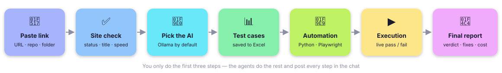
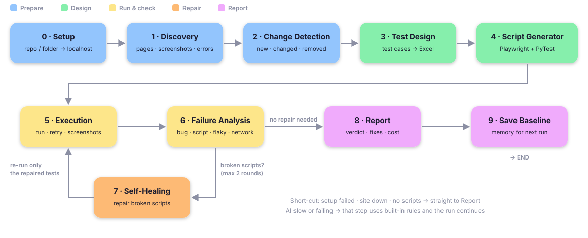

<div style="font-family: 'Segoe UI', Inter, system-ui, -apple-system, Roboto, Arial, sans-serif; line-height: 1.6;">

# ⚙️ Execution Process

### Blow AI – From "Paste a Link" to "Final Report"

| **Version** | 1.0 |
|---|---|
| **Date** | Oct 23, 2026 (checked against the code Nov 4, 2026) |
| **Average run** | minutes to an hour or more (depends on pages, AI engine, watching in Chrome and parallel browsers) |

This document explains what happens, step by step, when you start a test.

---

## 1. Overview



- **You do 3 things:** paste the link, check the site, pick the AI and press Start.
- **The agents do the rest** and post every step in the chat.

## 2. Before the Run

### 2.1 Website Check
- The server opens the URL **once** (12-second limit).
- Shows: page title, HTTP status, load time.
- GitHub links and folders are only **recognised** here (they are started in step 3.1).

### 2.2 Choose the AI
- **Engine:** Ollama (default), Gemini, OpenAI, Claude or No AI.
- **Model:** pick from the list.
- **API key:** only for cloud engines; used for this run only.
- **Options:** pages to test, a test account, your own tests (and the review), advanced settings, watch in Chrome
  (on by default), fresh start, and the required "I own this website / have permission" tick.

## 3. The Run – Step by Step



### 3.1 Open the Website (Setup Agent)
- **Website** → nothing to do.
- **GitHub repo** → cloned into `workspace/` (or downloaded as a .zip if git is missing).
- **Repo / folder** →
  - detects the project type (Node / React / Vite / Next / Angular, Django, Flask / FastAPI, plain HTML)
  - installs it
  - starts it on a free localhost port and waits up to 180 s
- **Output:** `setup.log`

### 3.2 Find Every Page (Discovery Agent)
- What it visits is decided from the link (`CRAWL_SCOPE=auto`, see Rules 1): from a home page link, every crawlable
  page on the same domain, up to `HARD_PAGE_CAP` (500) and `CRAWL_TIME_LIMIT_MIN` (30 min). An explicit page limit
  may be used for a bounded run.
- For each page: full-page screenshot, status, load time, console / JavaScript errors, failed requests.
- Collects links, buttons, inputs and forms with stable selectors.
- Clicks each safe button once: if it opens another page (no link to it), that page is tested too.
- **Login:** a login link (e.g. `site.com/login`) means "test the whole app behind it".
  - With a **test account** (typed in the chat, or `TEST_USERNAME` / `TEST_PASSWORD` in `.env`) it logs in and
    crawls every page behind the login in a second, logged-in browser session. The tests then start logged in.
  - Without one, only the public pages (login, register…) are tested, and the chat + report say so.
- **Chat:** "🔑 Logged in with the test account…" and "✓ I found N pages…"
- **Output:** `app_map.json`, `screenshots/`, `login.json`, `auth.json` (the saved login for the tests)

### 3.3 Compare With the Last Test (Change Detection)
- Compares with `baseline/<site>/`.
- Marks each page as new, changed, removed or unchanged.
- First run → every page is new.
- **Visual check** (`VISUAL_CHECK`, on by default): each page's look at desktop and phone width vs. its approved look
  (`baseline/<site>/visual/`); a change is for you to judge and approve, never a bug by itself.
- **Output:** `changes.json`, `visual.json` + `visual/`

### 3.4 Write Test Cases (Test Design Agent)
- **Chat:** "⏳ Now generating the test cases…"
- **25 test cases per run** for the whole site (plus the one-feature checks):
  - **20 large end-to-end test cases** – each one does several things, step by step, often across pages.
    - With AI: the AI designs 20 real user journeys that together use every feature
      (e.g. search → add to cart → open the cart → the item is shown), stopping before checkout / pay.
      Its code is written 5 journeys at a time (one bad answer loses 5, not all 20) and made steady before it
      runs (a text that matches several elements → the first visible one; counts wait for the page).
    - Without AI (or if the AI fails): built-in **real user journeys** first – each one keeps going like a person,
      without reloading between steps:
      - log in with the test account → open every page behind the login → you stay logged in
      - search an item → add it to the cart → open the cart → the item is listed (checkout is never clicked)
      - fill a whole form with normal values (name, email, phone, dropdown, choice, tick boxes) → no box shows
        an error (the form is never sent)
      - click through the website's menu → every link opens the right page (as a visitor and logged in)
    - Then built-in large cases made from every other feature of every page – up to 20 large cases in total,
      each with at least 3 steps (a small site may get fewer).
    - The steps cover: search, add to cart, quantity + / −, every dropdown option, radio choice and checkbox,
      calendars / lists / suggestion boxes, tabs, popups, alert boxes, table sorting, next page, sliders,
      file upload (never sent), drag and drop, hover menus, forms (empty / invalid email rejected), login
      (wrong password rejected; test account works) and every safe button.
    - A large case runs every step, even after one fails, and lists every failed step at the end.
  - **5 small checks**, each run on every page: pages open · no JavaScript errors · pictures load ·
    every link works · input boxes handle wrong and unusual values (only typed, never sent).
- Unsafe buttons are never clicked.
- **Chat:** table preview + "👀 Please go through the test cases while I write the automation" + **View** / **Download**
- **Review (optional):** with "Let me review the test cases" (or `REVIEW=on`, and always on staging) the run waits
  up to 15 minutes: untick test cases, answer its questions, add your own tests.
- **Output:** `test_cases.json`, `test_cases.xlsx`

### 3.5 Write Automation Scripts (Script Generator)
- **Chat:** "⏳ Writing the automation now… (Python · Playwright · PyTest)"
- `test_flows_ai.py` (the AI's large cases) and `test_journeys.py` (built-in journeys); `test_checks.py` +
  `steps_<page>.py` (one focused check per feature / control), `test_features.py`, `test_learned.py`;
  `test_site.py`, `test_all_links.py`, `test_<page>_data.py` (the small checks); and, when the site has them,
  `test_forms.py`, `test_items.py`, `test_mobile.py`, `test_roles.py`, `test_field_rules.py`, `test_cleanup.py`.
- AI code is validated → one fix attempt per batch of 5 → else that batch is left out (the built-in cases still run).
- **Coverage list:** every control found is marked tested / not tested (with the reason), checked against the
  real test code – shown in the chat, the Excel sheet "Coverage" and the report section "What was tested".
- **Chat:** "✓ I turned the test cases into N automated test scripts" + the coverage list
- **Output:** `generated_tests/`

### 3.6 Run the Tests (Execution Agent)
- **Order:** the large end-to-end test cases run **first**, then the small checks (pages open, JavaScript errors,
  pictures, input values), the link checks **last**.
- **Hidden mode:** 4 browsers in parallel.
- **Watch mode:** 1 visible Chrome window with a red caption for every action.
- Each result is written live → the case turns **Passed / Failed** in the chat.
- With `TEST_RETRIES=1` (0 by default) failures are run again → **flaky** if they pass the second time.
- Every link on the site is also checked.
- **Output:** `results.jsonl`, `results.json`, `failure_screenshots/`

### 3.7 Analyse Failures (Failure Analysis)
- Each failure → website bug / locator / script bug / flaky / infrastructure / timeout …, with a severity.
- The AI adds a plain-English explanation (if enabled). With `VISION` it also looks at the failed test's
  screenshots and may mark it a *test mistake* or *suspect* (Rules 5.1).
- **Output:** `failures.json`

### 3.8 Repair Broken Scripts (Self-Healing) – Only If Needed
- **Chat:** "Some test scripts broke (not the website). I'm repairing them…"
- First: selector matching (free, no AI). Then: AI repair.
- Assertions can never be removed.
- Repaired tests go back to step 3.6 (only those tests).
- Maximum 2 rounds.
- **Output:** `healing_log.json`, `healing/`

### 3.9 Final Report (Report + Save Baseline)
- Verdict by fixed rules.
- What works well, what to fix (why · how · code change), pages, AI cost.
- Final Excel with execution status.
- Baseline saved for the next run.
- Slack message / Jira issues for application defects, only when they are set up in `.env`.
- **Chat:** "✅ Testing completed" + the report card.
- **Output:** `report.html`, `summary.json`, `metrics.json`, `cost.json`, `baseline/<site>/`, `integrations.json`

## 4. After the Run (Optional)

### 4.1 Apply the Fixes
1. Give the website's GitHub repo.
2. **Prepare changes** – shows the exact code changes (nothing is sent).
3. **Create Pull Request** – new branch + PR on GitHub.

### 4.2 Re-run the Generated Tests Later
```powershell
cd runs\<site>_<time>\generated_tests
..\..\..\.venv\Scripts\python.exe -m pytest -q
```

## 5. When Something Goes Wrong

- **App could not start** → straight to the report → *Insufficient Evidence*.
- **No page loaded** → failure analysis → report.
- **No scripts written** → failure analysis → report.
- **AI slow or failing** → that step uses built-in rules; one warning in the chat.
- **Ollama not running** → the whole run uses built-in rules.
- **You press ■ Stop** → the run stops at its next safe point and still writes a report of what was done
  (*Insufficient Evidence*, the reason first); status *Stopped*. `main.py --resume <run>` can go on with it.

## 6. Running Without the UI

### 6.1 Terminal Commands
```powershell
cd blow-ai
.venv\Scripts\python.exe main.py https://the-internet.herokuapp.com --max-pages 15
.venv\Scripts\python.exe main.py <source> --show-browser        # watch the browser
.venv\Scripts\python.exe main.py <source> --fresh               # forget the last run
.venv\Scripts\python.exe main.py <repo> --start-cmd "npm run dev -- --port {port}"
.venv\Scripts\python.exe main.py --help                         # every option (README, section 4)
```
Calling `.venv\Scripts\python.exe` directly needs no activation (so no `Set-ExecutionPolicy` change).

### 6.2 Shortcut
- `run.bat https://your-site.com` – runs in the terminal and opens the report at the end.

### 6.3 Test the Tester Itself
```powershell
.venv\Scripts\python.exe -m pytest -q -n 3 --dist loadfile -m "not slow"   # quick tests (all tests: tests/README.md)
```

---

**Related documents:** [PRD](01_PRD.md) · [Architecture](02_ARCHITECTURE.md) · [Rules](03_RULES.md) ·
[Design](04_DESIGN.md) · [Installation](06_INSTALLATION.md)

</div>
